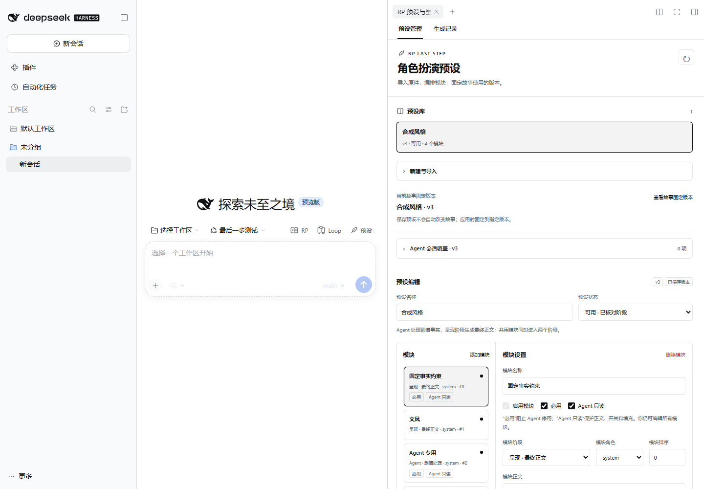
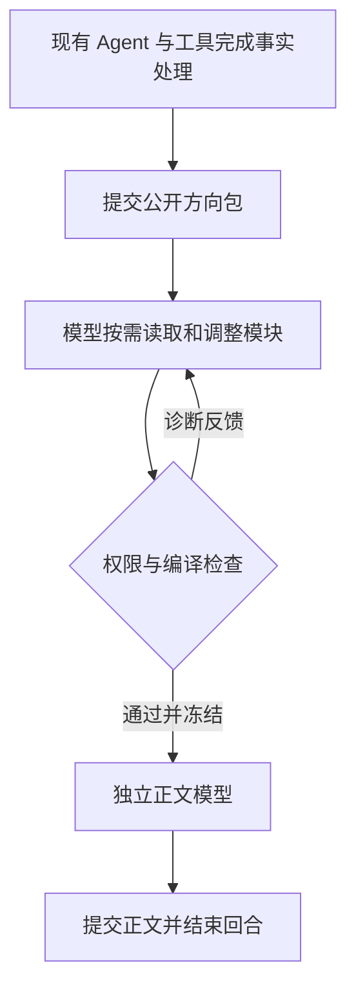

# DSH RP 最后一步

让 Agent 在模拟与工具工作完成后，按需组装提示词模块，再由独立模型生成最终正文。支持导入 SillyTavern 提示词预设、自建模块，以及用户掌握的“必用”和“Agent 只读”策略；导入原件保持不变。

Native DSH plugin for adapting SillyTavern presets, assembling permission-aware prompt modules, and rendering final RP prose from resolved public facts.

[下载安装包](https://github.com/LiweiDonVee/dsh-rp-last-step/releases/latest) · [使用与迁移](docs/usage.md) · [工具与架构](docs/architecture.md) · [开发与验证](docs/development.md) · [更新记录](CHANGELOG.md)



## 核心流程



本插件负责预设迁移、热组装和呈现。模拟、工具判定、角色状态和剧情结算仍由已安装的 Agent／工具提供。正文模型没有世界工具或主 Agent 历史，只接收公开方向包、呈现模块与显式公开材料。

## 安装

0.3 需要 **DSH 0.2.1-rc.3** 或更新的兼容版本。正式呈现需要 **原生工具模式**；纯 PTC 会话可迁移、编辑和预览，不能启用终止呈现。插件不会自动修改工具模式。旧 0.2.0 的 rc.2 验收记录保留作历史证据。

1. 从 [Releases](https://github.com/LiweiDonVee/dsh-rp-last-step/releases/latest) 下载 `dsh-rp-last-step-0.3.0.tgz`。
2. 完全退出 DSH，包括后台进程。在文件所在目录执行：

```powershell
dsh plugin --profile desktop add ./dsh-rp-last-step-0.3.0.tgz
```

3. 重启 DSH，点击会话顶部的 **预设**，或从右侧新增页签导航打开 **RP 最后一步**。

Web 模式将 `desktop` 改为 `web`。不需要另开服务、安装 Node/pnpm 或复制 token。Windows 找不到 `dsh` 时，默认安装可使用：

```powershell
$dshCli = Join-Path $env:LOCALAPPDATA 'Programs/DeepSeek Harness/resources/runtime/cli/bin/dsh.cmd'
& $dshCli plugin --profile desktop add ./dsh-rp-last-step-0.3.0.tgz
```

自定义安装位置请改为对应启动器。升级同样安装新版 tgz 并重启。发布页附 `SHA256SUMS.txt`；使用 `Get-FileHash ./dsh-rp-last-step-0.3.0.tgz -Algorithm SHA256` 核对。

## 从导入到第一轮正文

1. 打开预设管理，导入 ST JSON 或新建预设。可以先试 [合成示例](examples/minimal-st-preset.json)。
2. 点击生成 Agent 适配草稿，或自行将模块分为 **Agent 层、呈现层、共享**。配套 skill 会拆分混合职责，保留文风、来源和默认启停，并记录不支持的宏或扩展。
3. 审阅迁移报告和正文，设置模块的 **必用**、**Agent 只读** 及启停状态。迁移结果始终是草稿，不会自动应用。
4. 检查编译预览，解决未分类模块、缺失变量和未映射标记。把预设设为可用，保存新版本，再点击 **应用到当前故事**。
5. 向已有 RP Agent 发送行动。它完成工具和事实处理后，单独调用 `rp_present`；模块组装通过检查后，正文模型才开始写作。

成功后直接结束回合，主 Agent 不再复述正文。插件自带 **生成记录** 页，可查看本会话已提交稿件。想获得故事分支、回退和沉浸阅读体验，可同时安装 RP Studio。

## 用户与 Agent 分别能改什么

| 设置 | 用户 | Agent |
| --- | --- | --- |
| 必用模块 | 可设置、改正文 | 不能停用或使编译结果为空；未锁正文仍可调整 |
| Agent 只读模块 | 可编辑 | 不能改正文、开关或已有填充 |
| 普通模块 | 可编辑、排序和分类 | 可在会话覆盖层启停、改写、填写 |
| 临时模块 | 可查看覆盖 | 可添加受限呈现模块，并移除自己新增的临时模块 |
| 来源文件、预设版本、阶段与策略 | 用户管理 | 工具不能修改 |

原始导入文本、派生预设版本、会话覆盖是三个层次。保存新版本不会改变已绑定故事，应用时才固定版本；Agent 的热修改不会写回原件或全局预设。完整规则见 [使用指南](docs/usage.md)。

## 模型分工与其他插件

| 独立项目 | 提供的能力 |
| --- | --- |
| **RP 最后一步** | 本仓库：预设迁移、热组装与正文 |
| [Loop Studio](https://github.com/LiweiDonVee/dsh-loop-studio) | 图形化配置迁移、组装、正文的模型，含已接入 DSH 的本地模型 |
| [RP Studio 1.2+](https://github.com/LiweiDonVee/dsh-rp-studio) | 原生故事页、预设入口、安全正文流和规范叙事回放 |

三者独立安装。未安装 Loop 时，迁移使用会话当前选择；最终组装和正文沿用本轮主请求的实际模型。安装 Loop 后，显式节点配置优先。模型失败不会暗中切换到别的提供方。


旧 RP 预设如果有专用末端渲染命令，需要把末端流程改为 `rp_present`。插件不会拦截未知世界工具，也不附带角色卡、世界或基础模拟引擎。工具参数示例见 [架构文档](docs/architecture.md)。

## 数据库与主动上下文

可选安装 [RP Database](https://github.com/LiweiDonVee/dsh-rp-database) 与 [RP Context](https://github.com/LiweiDonVee/dsh-rp-context)。中间 GM 对固定数据库版本的会话覆盖进行检索、候选外搜索、选择排序与允许的编辑，并主动展开或折叠有效历史；最后一步接收冻结材料，writer 不获得数据库写权限。人物知情使用叙事备注，仍由 GM 判断。

数据库和历史材料在提示词模块组装前冻结，最近正文同步进入写作输入。关闭或未安装主动上下文时保持原有行为；本插件不替换 DSH 主循环压缩后端。

失败且已冻结材料的稿件可从 `rp_last_step_catalog` 的 `presentations` 中查看可重试 ID，然后单独调用 `rp_present({rewriteOf: id})`。仅重新调用 writer，不重复 GM、模块组装或事实工具。原来源已回退、已有有效成功重试或仍在运行时会拒绝。此操作不覆盖已成功稿件。

[组合验收记录](docs/fullstack-acceptance.md)。参考分析见 [DV fork 审查](docs/reference-review-tavern2agent.md)。组合验收：`node scripts/fullstack-smoke.mjs`，设置 DSH_DATABASE_TGZ、DSH_CONTEXT_TGZ、DSH_LOOP_TGZ 指向各发布包。

## 数据与当前边界

数据保存在 `$DSH_HOME/app-data/rp-last-step/`；未设置 `DSH_HOME` 时使用 `~/.dsh`。关闭 DSH 后可备份这个目录，包含来源、预设版本、会话覆盖和呈现记录。

ST 脚本、正则、插入深度、世界书标记和宏不自动获得完整运行语义。原始字段保留供回溯，迁移报告明确未适配项；模型生成的迁移内容仍需人工审阅。

生成记录是已提交稿件档案，当前剧情分支以 RP Studio 故事页为准。可选复核模型、专用正文重试按钮及自由编辑流程尚未提供；失败不代表可以重新运行已经完成的状态工具。更多说明见 [使用与恢复](docs/usage.md) 和 [验收记录](docs/acceptance.md)。

## 开发

需要 Node 24 与 pnpm 11.9，不需要 Electron 或 RP Studio 源码：

```powershell
git clone https://github.com/LiweiDonVee/dsh-rp-last-step.git
cd dsh-rp-last-step
pnpm install --frozen-lockfile
pnpm check
pnpm package
```

产物在 `artifacts/`，迁移 skill 自动进入安装包。`pnpm smoke` 使用官方 DSH 和模拟模型进行隔离验收；三插件联用检查见 [开发文档](docs/development.md)。

MIT 许可证。初始实现源自 [RP Studio 集成版本](https://github.com/LiweiDonVee/dsh-rp-studio/commit/f0c7cbba469b28b730b8b895ed2250c1d235fc77)，本仓库是 RP 最后一步后续开发与发布的主仓库。
